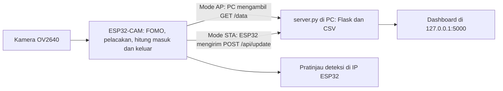

# Penghitung Pengunjung dengan ESP32-CAM

Alat penghitung pengunjung pameran berbasis **ESP32-CAM** dan model deteksi orang **Edge Impulse FOMO** yang berjalan langsung di perangkat (*edge AI*). Kamera menghitung orang yang masuk dan keluar melewati garis virtual, lalu jumlahnya ditampilkan di dashboard pada PC.

Proyek ini dikembangkan sebagai **capstone project** untuk lomba. Repositori ini berisi kode, panduan menjalankan sistem, serta rencana dan alat bantu pengujian untuk tim.

## Fitur

- Deteksi orang di ESP32-CAM tanpa internet (FOMO MobileNetV2 0.35, input 96x96 grayscale, int8).
- Pelacakan sederhana dan penghitungan masuk/keluar melalui garis virtual.
- Halaman **pratinjau deteksi** di ESP32 untuk melihat gambar, posisi orang, dan garis hitung.
- **Dashboard** di PC: jumlah orang di dalam ruangan, total masuk/keluar, grafik per jam, status kamera, unduh CSV.
- Dua mode jaringan: ESP32 membuat WiFi sendiri (**mode AP**) atau menyambung ke hotspot yang ada (**mode STA**).
- Data harian tersimpan otomatis ke CSV, aman walau ESP32 atau server restart.

## Arsitektur



## Struktur folder

```
esp32cam-people-counter/
├── firmware/esp32_penghitung/esp32_penghitung.ino   Program ESP32-CAM
├── server/
│   ├── server.py          Server Flask: menerima/mengambil data, simpan CSV
│   ├── dashboard.html     Tampilan dashboard (tanpa internet)
│   ├── simulasi.py        Uji dashboard tanpa ESP32
│   └── requirements.txt
├── pengujian/
│   ├── lembar_akurasi.csv Templat lembar uji akurasi
│   ├── catat_serial.py    Perekam log Serial ESP32
│   └── analisis.py        Pengolah hasil uji menjadi tabel dan grafik
└── docs/                  Panduan langkah demi langkah
```

## Alat dan bahan

| Komponen | Keterangan |
|---|---|
| ESP32-CAM (AI Thinker) | Dengan PSRAM 4 MB dan kamera OV2640 |
| ESP32-CAM-MB | Shield USB untuk upload program |
| Adaptor 5V 2A + kabel USB | Daya kurang menyebabkan ESP32 restart sendiri |
| PC/laptop | Windows, Linux, atau macOS dengan Python 3.9+ |
| Opsional | Lensa wide-angle OV2640, casing/bracket, antena eksternal |

## Mulai cepat

1. **Siapkan perangkat lunak**: Arduino IDE 2.x, paket board **esp32 by Espressif Systems versi 2.0.17**, dan Python. Lihat [docs/01-perangkat-dan-instalasi.md](docs/01-perangkat-dan-instalasi.md).
2. **Latih atau clone model** di Edge Impulse, ekspor sebagai Arduino library. Lihat [docs/02-melatih-model.md](docs/02-melatih-model.md).
3. **Upload firmware** ke ESP32-CAM. Secara bawaan ESP32 membuat WiFi `Penghitung-Pengunjung` (password `12345678`).
4. **Jalankan server** di PC:
   ```bash
   cd server
   pip install -r requirements.txt
   python server.py
   ```
5. Sambungkan PC ke WiFi `Penghitung-Pengunjung`, lalu buka:
   - Dashboard: http://127.0.0.1:5000
   - Pratinjau kamera: http://192.168.4.1

Panduan lengkap ada di [docs/03-menjalankan-sistem.md](docs/03-menjalankan-sistem.md).

## Panduan

| No | Dokumen | Isi |
|---|---|---|
| 1 | [Perangkat dan instalasi](docs/01-perangkat-dan-instalasi.md) | Arduino IDE, board ESP32, Python |
| 2 | [Melatih model](docs/02-melatih-model.md) | Clone proyek Edge Impulse, ganti ke FOMO, ekspor |
| 3 | [Menjalankan sistem](docs/03-menjalankan-sistem.md) | Upload, mode jaringan, dashboard, pratinjau |
| 4 | [Pengujian dan penyetelan](docs/04-pengujian-dan-penyetelan.md) | Pemasangan kamera, uji akurasi, parameter |
| 5 | [Troubleshooting](docs/05-troubleshooting.md) | Error compile, WiFi, upload |
| 6 | [Rencana pengujian](docs/06-rencana-pengujian.md) | Uji fungsional, akurasi, kinerja, ketahanan, dan luaran untuk lomba |

## Hasil awal (sebelum pengujian lapangan)

| Ukuran | Nilai |
|---|---|
| F1 score validasi (int8) | sekitar 0,70 |
| Waktu inferensi di ESP32-CAM | sekitar 670 ms per frame |
| Pemakaian RAM puncak model | sekitar 115 KB |
| Ukuran model di flash | sekitar 81 KB |

Akurasi di lokasi nyata sangat dipengaruhi posisi kamera dan pencahayaan. Menambahkan foto dari lokasi pemasangan ke dataset biasanya paling banyak menaikkan akurasi.

## Privasi

Alat ini hanya menyimpan **angka hitungan**, bukan foto. Halaman pratinjau menampilkan gambar kamera hanya di jaringan lokal dan bisa dimatikan dengan `AKTIFKAN_PRATINJAU = false` saat dipakai di acara sungguhan. Pasang pemberitahuan di lokasi bahwa area tersebut dipantau kamera penghitung.

## Lisensi

Kode di repositori ini menggunakan lisensi [MIT](LICENSE). Library Edge Impulse dan model hasil ekspor mengikuti ketentuan Edge Impulse dan tidak disertakan di repositori ini.

## Penulis

Ryfial Azhar, Program Studi Informatika, Universitas Tadulako.
