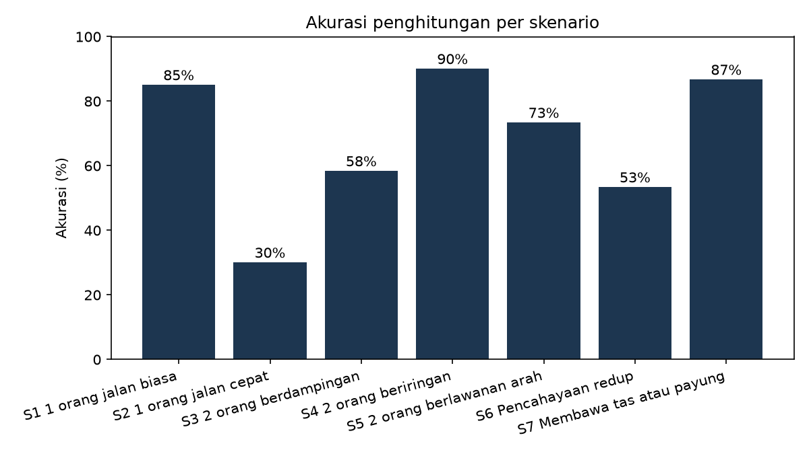
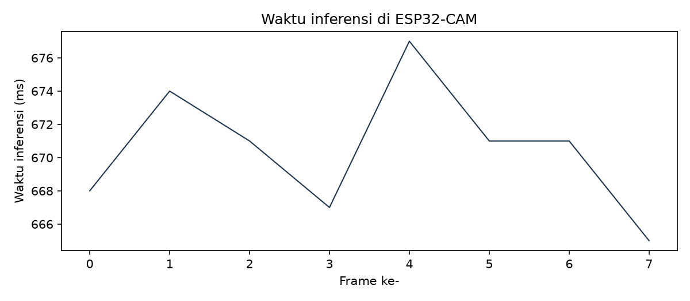

# Ringkasan Hasil Pengujian

## Akurasi penghitungan

| Skenario | Ulangan | Lintasan (manual) | Terhitung (alat) | Akurasi | Terlewat | Dobel | Arah terbalik |
|---|---|---|---|---|---|---|---|
| S1 1 orang jalan biasa | 3 | 60 | 55 | 85.0% | 7 | 2 | 2 |
| S2 1 orang jalan cepat | 3 | 60 | 18 | 30.0% | 42 | 0 | 0 |
| S3 2 orang berdampingan | 3 | 60 | 35 | 58.3% | 25 | 0 | 0 |
| S4 2 orang beriringan | 3 | 60 | 54 | 90.0% | 6 | 0 | 0 |
| S5 2 orang berlawanan arah | 3 | 60 | 44 | 73.3% | 7 | 0 | 9 |
| S6 Pencahayaan redup | 3 | 60 | 32 | 53.3% | 28 | 0 | 0 |
| S7 Membawa tas atau payung | 3 | 60 | 68 | 86.7% | 0 | 8 | 0 |

Akurasi keseluruhan: **68.1%** dari 420 lintasan.

## Kinerja inferensi

| Ukuran | Nilai |
|---|---|
| Jumlah sampel | 8 |
| Rata-rata | 670.5 ms |
| Simpangan baku | 3.9 ms |
| Minimum / maksimum | 665 / 677 ms |
| Perkiraan laju proses | 1.49 frame per detik (inferensi saja) |

